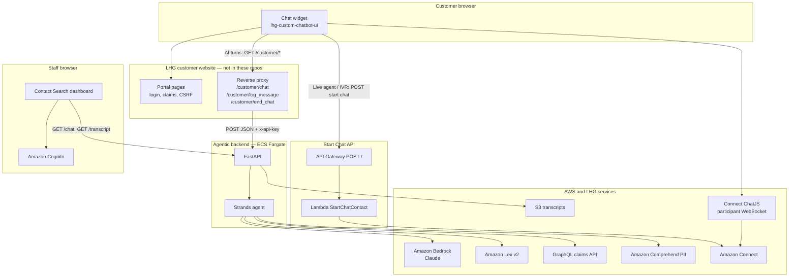

# Liberty Home Guard — Agentic Chatbot System Handover

**Date:** 15 October 2026
**Prepared from:** local clones of the four repositories below, comparing `origin/main` (production pipeline) with `origin/dev` (sandbox pipeline) and the open remote branches.
**Scope note:** This document describes what the code and pipelines do. It does not confirm the last successful deploy in AWS. Before go-live sign-off, match CloudFormation, Amplify, and S3 against the environment tables in section 6.

---

## 1. What this system is

The chatbot is a customer-support front door on the Liberty Home Guard website and customer portal. A floating widget on the site talks to an AI agent for policy and claim questions, and hands the customer to Amazon Connect when they need a live agent, billing, claims filing, or a scripted Connect flow.

Four repositories make up the chatbot itself. A fifth system, the Liberty Home Guard customer website, is required and is not in these repos. That site hosts the widget and proxies the AI calls.

| Repo | Role | Runtime | How it is deployed |
|---|---|---|---|
| `lhg-custom-chatbot-ui` | Embeddable chat widget | Vanilla JavaScript, no build step | GitHub Actions copies files to S3 |
| `lhg-custom-startchatcontact-api-chatbot` | Public API that starts an Amazon Connect chat | Node.js 22 Lambda (AWS SAM) | Reusable SAM pipeline on PR close to `dev` or `main` |
| `lhg-agentic-chatbot` | AI backend (this repo) | Python 3.12, FastAPI, Strands Agents, on ECS Fargate | GitHub Actions builds a Docker image and deploys CloudFormation |
| `lhg-agentic-chatbot-contact-search` | Supervisor dashboard for past and in-progress chats | React 19 + Vite | AWS Amplify (no workflow file in the repo) |

GitHub org: `LibertyHomeGuard`.

---

## 2. Overall architecture



Two chat paths run side by side.

**AI path.** The widget calls the website origin, not the backend URL directly:

- `GET {website}/customer/chat/`
- `GET {website}/customer/log_message/`
- `GET {website}/customer/end_chat/`

The website must turn those GET calls into the FastAPI contract (`POST /chat`, `POST /log_message`, `POST /end_chat`) and attach the `x-api-key` header. That proxy is not in any of the four repos. The widget config key `chatApiUrl` is written at deploy time (`https://website.sb20.lhg.pp.ua/` in dev, `https://www.libertyhomeguard.com/` in prod) but the widget JavaScript does not read it. Behavior follows `window.location.origin`.

**Connect path.** For a live agent, billing, file-a-claim, guest, or authenticated Connect flow, the widget POSTs to the Start Chat API. The Lambda calls `connect:StartChatContact` and returns `ContactId`, `ParticipantId`, and `ParticipantToken`. The bundled Amazon Connect ChatJS SDK (`amazon-connect-chat.js`) opens the participant WebSocket. This API does not return a WebSocket URL.

There is a second Connect caller inside the AI backend: the `transfer_to_ava` tool also calls `StartChatContact` and `CreateParticipantConnection`. The widget does not use the WebSocket URL from that tool. On a transfer action it starts its own Connect chat through the Start Chat API, using the `connectAgentFlow` id from `config.json`. Treat the backend tool and the widget handoff as two mechanisms until someone confirms which one production traffic actually uses.

---

## 3. How one customer conversation works

### 3.1 Widget load

1. The website loads `loader.js` from the chatbot CDN.
2. The loader reads its own script URL and pulls, from the same origin: `chatbot.css`, `amazon-connect-chat.js`, `chatbot-claim-dynamic-questions.js`, `config.json`, and `chatbot-widget.js`.
3. `config.json` is not in git. GitHub Actions writes it during deploy. `config.example.json` is a local template and does not match the deployed flags (`strandsSessionControl` is `false` in the example and `true` in both dev and prod pipelines).
4. The widget creates `window.LHGWidget`. A logged-in portal customer stays on the AI path. A guest chooses existing versus new customer, which can open a Connect flow instead.

`mobile.html` is a full-screen host for an in-app WebView. It talks to the app through `window.ChatBridge` (`close`, `request_mic`).

### 3.2 AI turn

1. If session control is on, the widget sends `GET /customer/chat/?_session_event=start&session_event=start`.
2. A customer message goes to `GET /customer/chat/?text=...&session_id=...`, with optional `policy_no` and `coverage_item`.
3. The website proxy posts that to FastAPI `POST /chat` with header `x-api-key`.
4. `api/app.py` `chat()` checks the key, then `agent/strands_agent.py` `run()`:
   - Redacts PII with Amazon Comprehend before the model sees the text.
   - On **production (`main`)**: keyword and regex fast paths can answer without a full model turn (claim id, transfer phrases, Lex FAQ, live-agent yes/no). Anything else goes to the Strands agent.
   - On **dev (not in prod yet)**: fast routing was removed. The brain model routes, rephrases unclear input, and a Lex recovery step retries failed FAQ matches. See section 7.
5. The agent may call a tool (section 4).
6. The reply is stored in S3. The widget renders it. AI replies are request/response HTTP. There is no token streaming.

### 3.3 Live agent turn

1. The customer picks a menu (agent, billing, claim, new customer) or the AI returns an action such as `transfer_to_ava`.
2. The widget POSTs to `config.apiEndpoint` with `ContactFlowId`, `InstanceId`, `ParticipantDetails.DisplayName`, and optional email, mobile, and `customerSession`.
3. Lambda starts the Connect chat and returns `data.startChatResult`.
4. ChatJS connects. Messages, typing, and attachments then go through the Connect participant connection, not through the AI backend.
5. On AI failure the widget can fall back to the GCS Connect flow (`gcsflowId`).

### 3.4 End

End Chat asks for feedback (Statsig), then:

- Connect: `disconnectParticipant()` and clear `localStorage` keys `aws_chat_details` and `aws_chat_flow_id`.
- AI: `GET /customer/end_chat/?session_id=...`, which the proxy should turn into `POST /end_chat`. The backend writes a completed marker in S3. A completed session returns HTTP 409 if the customer tries to continue it.

### 3.5 What staff see

Contact Search is a separate React app. After Cognito login it calls the same FastAPI service:

| Dashboard action | Backend |
|---|---|
| Load the contact grid | `GET /chat?dateRange=...` |
| Open a transcript | `GET /transcript/{sessionId}` |
| Simulate a customer message | `POST /chat` |
| End a chat | `POST /end_chat` |

The grid is built from S3 session indexes, not from Amazon Connect Contact Search, OpenSearch, or Salesforce. In-progress rows refresh about every 20 seconds. An open in-progress transcript refreshes about every 10 seconds.

---

## 4. Integrations and connection points

### 4.1 Amazon Bedrock

Used only by the AI backend.

| Model | Id in code | Used for |
|---|---|---|
| Claude Sonnet 4.5 | `us.anthropic.claude-sonnet-4-5-20250929-v1:0` | Brain / orchestration (`BRAIN_MODEL_ID`) |
| Claude Sonnet 4 | `us.anthropic.claude-sonnet-4-20250514-v1:0` | Damage image analysis |
| Claude Haiku 3.5 | `anthropic.claude-3-5-haiku-20241022-v1:0` | Short claim summaries on `main` |

Dev adds `CLAIM_STATUS_SUMMARIZER_MODEL_ID`, default `us.anthropic.claude-haiku-4-5-20251001-v1:0`, for the newer claim-status wording. That code is not on `main`.

Region for the service is `us-west-2`. Models use inference profiles (`us.anthropic...`) where the id starts with `us.`.

### 4.2 Tools the agent can call

Registered in `agent/strands_agent.py`.

| Tool | File | Talks to | Production status |
|---|---|---|---|
| `kb_agent` | `tools/kb_agent.py` | Amazon Lex v2 `RecognizeText` | Live. This is the FAQ path. It does not query a Bedrock Knowledge Base, despite older README wording. |
| `get_claim` | `tools/claim_agent.py` | GraphQL `getCustomerById` / claim lookup, header `x-api-key` | Live. Needs `customer_id` from the logged-in portal session. |
| `check_claim_by_category` | `tools/claim_agent.py` | Same GraphQL API, optional Haiku summary | Live |
| `analyze_image` | `tools/image_analyser_agent.py` | Bedrock vision | Live |
| `transfer_to_ava` | `tools/transfer_tool.py` | Connect `StartChatContact` plus participant connection | Code is live. The widget starts Connect itself on transfer. Confirm this tool is still required. |
| `create_claim` | `tools/claim_api.py` | In-memory dictionary | Mock only. Records disappear on restart. Filing a real claim is done by the widget against portal routes (`/saveticket/`, claim iframe), not this tool. |

GraphQL URL and API key come from Secrets Manager (`GRAPHQL_SECRET_NAME`, JSON field `API_KEY`). The URL itself is `GRAPHQL_API_URL` inside the env secret. It is not committed.

### 4.3 Amazon Lex

| | Dev | Prod |
|---|---|---|
| Bot id | `VTVWJYVVQ4` | `DEMMU6UXXZ` |
| Alias id | `O3YBPODYGT` | `G0J0QWPCKJ` |
| Locale | `LEX_LOCALE_ID` in the env secret | same |

Set in `.github/workflows/main.yml` and injected into the ECS task.

### 4.4 Amazon Connect — two instances in dev, one in prod

| Caller | Dev instance | Prod instance |
|---|---|---|
| Widget and Start Chat API | `1b312f9a-922b-4ec2-90da-16594b1c0111` | `eda352de-3910-47c8-a587-1bbd8cc7d505` |
| AI backend `transfer_to_ava` | `5e07015e-28e4-4f37-a9df-83d737dab3ea` | `eda352de-3910-47c8-a587-1bbd8cc7d505` |

Prod matches. Dev does not. A transfer started by the backend tool in dev lands on a different Connect instance than a transfer started by the widget.

**Start Chat API default contact flow** (Lambda env `CONTACT_FLOW_ID`, overridable per request):

| | Flow id | Stack |
|---|---|---|
| Dev | `f829d706-d752-42f6-b36d-80dfa1e7285a` | `lhg-dev-startchatcontactapi-chatbot` |
| Prod | `d2f4a0ff-08df-4b18-b375-deea0e502850` | `lhg-startchatcontactapi-customerchatbot` |

The widget sends `ContactFlowId` on every start, so these defaults are fallbacks. Flow ids the widget actually chooses:

| Config key | Purpose | Dev | Prod |
|---|---|---|---|
| `contactFlowId` | Existing / skip-login guest | `f829d706-d752-42f6-b36d-80dfa1e7285a` | `d2f4a0ff-08df-4b18-b375-deea0e502850` |
| `newcustomer_contactFlowId` | New customer | `17436742-30ee-432a-b511-eb8277b43ac9` | `be13e484-f9e6-4eff-bd8d-43cf577462bb` |
| `authencatedFlowId` | Logged-in Connect flow (spelling is intentional in code) | `6f3662b7-10a0-459f-bc5f-d05ada180dae` | `70558866-c011-411b-86c7-58a01130ca68` |
| `fileclaim` | File a claim | `679fac76-e094-48e3-93b7-0bfb1bcfee3e` | `1a006e5c-dd94-498c-b237-b52a953c4cc4` |
| `connectAgentFlow` | Live agent | `622de85f-51e6-4557-90cf-b1978400908c` | `6e95c803-d62f-47e3-a7c3-6654d9e50934` |
| `gcsflowId` | Fallback when the AI call fails | `99e57933-59c2-4425-ab5d-f2257951c85b` | `33cb56f0-ffe0-413b-86a4-79c400b82050` |
| `billingId` | Billing | `a45aad42-76ec-4ba9-86bb-18cf7012c381` | `52e2407b-ba1a-49a0-929d-b866639759fe` |

**Attribute gap.** The Lambda copies only `customerName`, `customerEmail`, `EmailValue`, `customerMobile`, `PhoneNumberValue`, `customerSession`, and `chatFrom` onto the Connect contact. The widget also sends `Attributes`, `sessionId`, and `session_id`. The Lambda ignores those. `chatFrom` is supported by the Lambda and was added on the widget `dev` branch; it is not on widget `main`.

Backend Connect flow id (`CONNECT_FLOW_ID`) is only in the env secret, not in the workflow file.

### 4.5 Start Chat API contract

`POST {apiEndpoint}` with JSON. No API key, no Cognito authorizer, CORS `*`.

Success body the widget requires:

```json
{
  "data": {
    "startChatResult": {
      "ContactId": "...",
      "ParticipantId": "...",
      "ParticipantToken": "..."
    }
  }
}
```

| | URL in the widget pipeline |
|---|---|
| Dev | `https://euxa1chh8e.execute-api.us-west-2.amazonaws.com/Stage/` |
| Prod | `https://5roqr8nl91.execute-api.us-west-2.amazonaws.com/prod/` |

The dev URL stage name is `Stage`. The SAM parameter for dev is `StageName=dev`. Confirm in API Gateway that `/Stage/` is the stage that is actually deployed. `SPEC.md` on widget `main` still documents an older `us-east-1` URL. The workflow file is the source of truth.

Alarms publish to SNS:

- Dev: `arn:aws:sns:us-west-2:382625484581:lhg-dev-leadgen-sns-topic`
- Prod: `arn:aws:sns:us-west-2:766717188698:leadgen-sns-topic`

### 4.6 AI backend HTTP API

Public entry is an internet-facing Application Load Balancer, HTTP port 80 to container port 8000. There is no API Gateway in this repo.

| Method and path | Auth in FastAPI | Who calls it |
|---|---|---|
| `POST /chat` | `x-api-key` (`AGENTIC_CHATBOT_APP_API_KEY` from the GraphQL secret) | Website proxy, and Contact Search "simulate customer" |
| `POST /log_message` | None in the app | Website proxy, so Connect/widget lines land in the same S3 transcript |
| `POST /end_chat` and `POST /end_chat/{session_id}` | None in the app | Website proxy and Contact Search |
| `GET /chat?dateRange=` | None in the app | Contact Search grid |
| `GET /transcript/{session_id}` | None in the app | Contact Search |
| `GET /health` | None | Load balancer |
| `GET /sentry-debug` | `x-api-key` | Manual checks |

CORS defaults in `api/app.py` allow localhost plus:

- `https://www.contact-search.lhghwdev.com`
- `https://dev.d24ttjre8rhghc.amplifyapp.com`
- `https://www.contact-search.chatbot.lhgcts.com`
- `https://main.dmjj631r1pw48.amplifyapp.com`
- `https://website.sb19.lhg.pp.ua`

`ALLOWED_ORIGINS` can override that list. It is not one of the keys injected by `template.yml`, so production uses the list compiled into the image unless the env secret or task definition is changed outside this template.

### 4.7 S3 transcripts

| | Bucket (IAM parameter) | Account |
|---|---|---|
| Dev | `agentic-bot-test` | `307067290980` |
| Prod | `lhg-prod-datalake` | `766717188698` |

Prefix is `CONVERSATION_S3_PREFIX` from the env secret. Keys are partitioned by date: `.../year=.../month=.../day=.../session_{id}/`. A completed chat is marked with `status_completed.marker`. Contact Search reads this layout through the API. It does not read S3 itself.

PII redaction runs before storage (Comprehend, `agent/pii_redaction.py`).

### 4.8 Customer website routes the widget calls directly

Same origin, session cookies, CSRF token from `<meta name="csrf-token">`. These routes belong to the portal codebase:

- `POST /customer/checkLoginChatbot`
- `POST /customer/ValidateLogin/`
- `POST /customer/forgotPassword/`
- `GET /customer/logoutviaChatbot/`
- `GET /customer/fileaclaimChatbot/`
- `GET /customer/get_card_details`
- `GET /customer/getAllProducts/`
- `POST /customer/chatbot-fpa-sign-status/`
- `POST /check_coverage_item/`
- `POST /fetch-dimention-rule-by-coverage-item`
- `POST /saveticket/`
- iframe `/add-new-claim/{policyId}?view_mode=chatbot`

A 419 from these routes triggers a page reload in the widget.

### 4.9 Other third parties

| System | Where | Notes |
|---|---|---|
| Statsig | Widget → `https://events.statsigapi.net/v1/log_event` | Client key is written into `config.json` by CI. Tier `development` or `production`. |
| Google Translate and Cloud Text-to-Speech | Widget | API key is written into `config.json` by CI. |
| Sentry | Backend and Contact Search | Backend DSN is in the env secret. Contact Search uses `VITE_SENTRY_DSN`. |
| Amazon Cognito | Contact Search only | `VITE_COGNITO_USER_POOL_ID` and `VITE_COGNITO_CLIENT_ID` in Amplify env. Not in git. |
| PayPal | Claim payment step in the widget | Depends on the portal `saveticket` flow. |

The Google and Statsig client keys are stored in plaintext in `lhg-custom-chatbot-ui/.github/workflows/main.yml`. Rotate them as part of handover and move them to GitHub secrets or a config store. They are intentionally not copied into this document.

### 4.10 AWS accounts

| Account | Used for |
|---|---|
| `546460569274` | Shared ECR. Image repo `lhg-agentic-chatbot`. OIDC role `Github-acition-oidc`. |
| `307067290980` | AI backend **dev**. OIDC `lhg-dev-oidc-gh`. Secret `lhgdev/agentic-chatbot-env`. Stack `agentic-chatbot-stack`. |
| `382625484581` | Widget **dev** CDN and Start Chat **dev** SNS. Widget OIDC role `Github-acition-oicd` (assumed in `us-east-1`). |
| `766717188698` | **Prod** for the AI backend, the widget CDN, Start Chat SNS, and the prod OIDC role `leroi-gh-actions`. |

All Connect, Lex, Bedrock, and API Gateway endpoints in the current pipelines are `us-west-2`.

---

## 5. Repository walkthrough

### 5.1 `lhg-custom-chatbot-ui`

Embeddable widget. Not a React app. No `package.json`.

| File | Role |
|---|---|
| `loader.js` | CDN bootstrap |
| `chatbot-widget.js` | All chat behavior (`LHGWidget`, about 500 KB) |
| `chatbot-claim-dynamic-questions.js` | Dynamic claim questions |
| `amazon-connect-chat.js` | Vendored Connect ChatJS |
| `chatbot.css` | Layout and Ava branding |
| `mobile.html` | In-app WebView shell |
| `.github/workflows/main.yml` | Writes `config.json`, uploads to S3 |

Capabilities that are in the widget on `main`: launcher, Home / Messages / Help tabs, quick-reply menus (claim, policy, billing, account), login and password reset, dynamic claim questionnaire, image and file attachments, typing indicator, Spanish translation, read-aloud, voice input, thumbs feedback, session restore from `localStorage`.

Hosting:

- Dev bucket `s3://lhg-dev-chatbot-cdn/`
- Prod bucket `s3://lhg-custom-chatbot-cdn/`

CloudFront distribution ids and the public hostname of `loader.js` are not in this repo. Take them from the website HTML or the CloudFront console.

Deploy rule: push to `dev` updates only the dev bucket. Push to `main` updates the dev bucket first (with dev `config.json` but **main's source**), then the prod bucket.

### 5.2 `lhg-custom-startchatcontact-api-chatbot`

Small SAM service. Tracked source that matters:

| File | Role |
|---|---|
| `template.yaml` | API Gateway, Lambda, IAM, alarms |
| `samconfig.toml` | Dev and prod instance, flow, stack, region |
| `src/handlers/startChatContact.js` | `exports.handler` → `connect.startChatContact` |
| `.github/workflows/main.yml` | Calls `LibertyHomeGuard/lhg-sam-reusable-pipeline` |

Lambda is Node 22, 128 MB, 30 second timeout, with an `aws-sdk` v2 layer. IAM allows only `connect:StartChatContact` on the instance configured at deploy time. A request body can name another instance, and that call will fail IAM.

`main` and `dev` contain the same application code. `dev` has no commits that are absent from `main`. Environment differences are only the SAM parameters.

Manual deploy: `sam build`, then `sam deploy` (dev) or `sam deploy --config-env prod`.

### 5.3 `lhg-agentic-chatbot` (this repo)

| Path | Role |
|---|---|
| `api/app.py` | FastAPI routes, API key check, S3 aggregation for Contact Search, Sentry |
| `agent/strands_agent.py` | Agent construction, routing, S3 session writes |
| `agent/pii_redaction.py` | Comprehend redaction |
| `config/bedrock_config.py` | Model ids, AWS clients |
| `tools/` | Lex, claims, vision, Connect transfer, mock create-claim |
| `template.yml` | ECS cluster, task, ALB, IAM |
| `Dockerfile` | Python 3.12, `uvicorn api.app:app` on port 8000 |
| `.github/workflows/main.yml` | ECR build, dev stack, prod stack |

`package.json` depends on `@strands-agents/sdk` and is not copied into the image. Production is Python only.

Local run is `uvicorn api.app:app --reload` with a `.env`. There is no `.env.example` in the tree. README still describes an older Bedrock POC (Sonnet 3.5, Bedrock Knowledge Base, a `ui/` folder). Trust the code and `template.yml` over the README.

ECS desired count in the template is 1. Agent conversation state and the image-analysis store live in process memory. A second task, or a restart, drops that memory. Transcripts survive because they are in S3. Strands' own S3 session manager is disabled (`session_manager=None`); the widget and `append_session_message` own the transcript.

### 5.4 `lhg-agentic-chatbot-contact-search`

| Path | Role |
|---|---|
| `src/main.jsx` | Amplify Cognito and Sentry |
| `src/App.jsx` | `/` login, `/dashboard` protected |
| `src/pages/Dashboard.jsx` | Date range, polling, API calls |
| `src/components/ContactTable.jsx` | Grid, transcript, simulate, end chat |
| `amplify.yml` | `npm run build`, publish `dist/`, SPA rewrite |
| `.env.example` | `VITE_API_URL`, Cognito, Sentry, `VITE_ENVIRONMENT` |

`src/components/LiveChatPanel.jsx` is not imported. `details.md` on the `document` branch describes an older mock-login UI. The current `main` app uses Cognito.

There is no GitHub Actions workflow. Which Amplify branch is production is configured in the Amplify console, not in git. The backend CORS list is the best in-repo hint:

- Dev-style: `https://www.contact-search.lhghwdev.com`, `https://dev.d24ttjre8rhghc.amplifyapp.com`
- Prod-style: `https://www.contact-search.chatbot.lhgcts.com`, `https://main.dmjj631r1pw48.amplifyapp.com`

`VITE_API_URL` must point at the matching backend ALB. Those values are not in git.

---

## 6. Production versus sandbox

"Production" in this document means the `main` branch pipeline. "Sandbox / dev" means the `dev` branch pipeline. Feature branches are not deployed unless someone pushes them to `dev` or `main`.

### 6.1 Branch state on 15 October 2026

| Repo | `origin/main` | `origin/dev` vs `main` | What that means |
|---|---|---|---|
| Start Chat API | In sync with `dev` | No unique commits | Same code in both environments. Only Connect ids, stack names, and stage names differ. Safe to treat as released. |
| Contact Search | Contains everything on `dev` | `dev` is behind `main` (already merged) | Code is released. Live URL still depends on Amplify. Local checkout was on `document`, which is one docs commit ahead of an older `main` and is missing later merges. Do not deploy `document`. |
| AI backend | Stopped at merge PR #72 | **Ahead.** PRs #73 through #92 are on `dev` only | Dev is running a different agent than prod. |
| Widget | Has dynamic claim questions (PR #160) that `dev` does not | **Diverged.** `dev` has claim-status, chat-from, and ticket work that `main` does not | A straight merge in either direction will conflict. Prod and sandbox widgets are not the same feature set. |

### 6.2 AI backend: on `dev`, not on `main` / not in prod

About 980 lines added and 863 removed across 11 files (`agent/strands_agent.py` is most of it).

| Change | Why it matters |
|---|---|
| Keyword fast-routing removed. The brain model routes and rephrases customer text (`feature-full-model-routing`, PRs #74–#82). | Prod still uses regex and keyword shortcuts. Dev latency, cost, and answers will differ. |
| `tools/lex_recovery.py` | If Lex does not understand, dev retries with a reformulated utterance. Prod does not. |
| `agent/claim_selection_guard.py` | Stops the model from treating an ambiguous choice as a confirmed claim. |
| Claim id and policy number formats widened, including `TN` plus digits | Prod accepts a narrower pattern. |
| `tools/claim_status_summary.py` | Dev rewrites claim status in a constrained Claude Haiku 4.5 voice. Prod uses the older Haiku 3.5 summarizer path. |
| Claim-status intent returns a claim-status bubble for the widget | The widget half of this is also only on widget `dev`. Shipping one without the other leaves a broken pair. |
| Lakebase archive of completed chats | Added in PR #83 and **reverted** on `dev` (PR #92). Do not plan on Lakebase. |

### 6.3 Widget: each branch has work the other lacks

**On `dev`, not on `main`:**

- Claim-status bubble driven by the backend action
- `chatFrom` passed into the Start Chat payload (Lambda already supports it)
- Tickets referenced in history: AT-540, AT-573
- README, `DETAILS.md`, and architecture SVGs (PR #156). `SPEC.md` was removed on this branch
- Extra Statsig events were merged and then reverted

**On `main`, not on `dev`:**

- PR #160 `feature/Claim_Dyn_Qtns` — dynamic claim questions and a claim-issue fix
- Large updates to `chatbot-claim-dynamic-questions.js`, `chatbot.css`, and a small `loader.js` change

`chatbot-claim-dynamic-questions.js` was edited on both sides (hundreds of lines each way). Promote only after a real merge and a claim-filing pass on a sandbox site.

### 6.4 Feature branches that are not the deploy branches

These exist on the remotes. Several are already merged and are historical. Do not deploy from them.

AI backend remotes include: `feature-full-model-routing`, `feature-model-claimsatus`, `feature-rehydration`, `revert-lakebase-archive`, `feature-security-measures`, `feature-session-metadata`, `feature-session-index-partition`, `feature/api-security-observability-hardening`, `feature/agentic_apikey`, `feature/fetch-data-enhancement`. The routing, claim-status, and rehydration work that is still unreleased lives on `dev`, not only on the feature branch tips.

Widget remotes include: `feature/agentic-chatbot`, `feature/Claim_Dyn_Qtns`, `feature/claim_status`, `feature/claim_status_action`, `docs/readme-details-architecture`.

Contact Search remotes include: `document`, `feature/search`, `feature/fetch-data-enhancement`, `feature-amplify-deployment`, `demo-local-test`.

Start Chat has only `main` and `dev`.

### 6.5 Pipeline behavior that surprises people

**AI backend** (`.github/workflows/main.yml`):

- Push to `dev`: build image in account `546460569274`, deploy stack `agentic-chatbot-stack` in account `307067290980`.
- Push to `main`: the prod job is gated with `if: github.ref == 'refs/heads/main'`.
- The dev job has a comment that says it runs only on `dev`, but the `if:` line is not in the file. A push to `main` therefore deploys **main's image onto the dev stack**, then deploys prod (`prod_deploy` needs `dev_deploy`). Promoting to production currently overwrites sandbox with the production build.

**Widget:** same shape. A push to `main` uploads main's files into the **dev** bucket (using the dev `config.json`), then uploads to prod. Because `dev` is ahead of `main` on claim status, a production release will roll the sandbox widget backwards until someone pushes `dev` again.

**Start Chat:** the reusable workflow fires when a pull request **targeting `main` or `dev` is closed**, including closed-without-merge, unless the shared pipeline filters that. Confirm that in `LibertyHomeGuard/lhg-sam-reusable-pipeline`. This repo cannot show the filter.

**Contact Search:** Amplify builds whatever branch is connected. `amplify.yml` only runs `npm run build` and writes `dist/version.json`.

---

## 7. Auth and security

| Surface | What protects it today |
|---|---|
| `POST /chat` | Shared `x-api-key`. The widget never sees this key if the website proxy adds it. |
| `GET /chat`, `GET /transcript`, `POST /log_message`, `POST /end_chat` | No application auth. Anyone who can reach the ALB can list transcripts and end sessions. Contact Search sends a Cognito id token (`Authorization: Bearer`), and FastAPI does not check it. |
| Start Chat API | Public POST, CORS `*`, no WAF in the template. CloudWatch 5xx alarm threshold is `>= 0`, so any 5xx notifies SNS. |
| Widget third-party keys | In the GitHub workflow file in plaintext. |
| Claim data | `get_claim` is supposed to require the portal `customer_id`. The forced-tool path passes `claim_id` and can omit `customer_id`. Confirm the fast path on `main` always has the id before relying on it. |
| Connect IAM on the ECS task | `template.yml` allows voice-style actions (`StartOutboundVoiceContact`, `StopContact`, `GetContactAttributes`, `UpdateContactAttributes`). The tool calls `StartChatContact` and Connect Participant APIs. If transfer from the backend fails in an account, this mismatch is the first place to look. |
| Logs | Start Chat Lambda logs the full event, body, and Connect response, which includes customer name, email, and phone. Backend chat logging includes debug payloads. |
| Sentry (Contact Search) | `sendDefaultPii: true`. |

`getAccessToken()` in Contact Search returns the Cognito **id token**, not the access token.

---

## 8. Open items, known issues, and dependencies

### 8.1 Must resolve before treating dev as the next release

1. **Backend `dev` and widget `dev` are a pair.** Claim-status bubbles, model routing, and `chatFrom` need both sides. Prod has neither.
2. **Widget `main` has dynamic claim questions that `dev` does not.** Merging `dev` up to `main` without a careful merge will drop or fight PR #160.
3. **A production deploy overwrites sandbox** for both the AI backend and the widget, because the dev job is not actually limited to the `dev` branch.
4. **Two Connect instances in dev** (`1b312f9a-...` for the widget, `5e07015e-...` for `transfer_to_ava`). Prod uses one instance. Decide whether the backend tool should keep starting chats.
5. **Dev Start Chat URL stage is `/Stage/`** while SAM `StageName` is `dev`. Verify the live API Gateway stage before debugging "works in prod, fails in sandbox".

### 8.2 Product gaps

| Item | Detail |
|---|---|
| Create claim in the agent | `tools/claim_api.py` is an in-memory mock. Real filing is the portal widget flow. |
| Bedrock Knowledge Base | Not implemented. FAQ is Lex. |
| Lakebase archive | Reverted on `dev`. |
| Contact Search channel filter | Display-only. Backend always returns channel `Chat`. |
| Delete transcript | Button is disabled. |
| Download transcript | Icon runs the same action as expand-row. |
| `LiveChatPanel.jsx` | Unused. |
| Widget `restoreTranscript` | Defined twice in `chatbot-widget.js`. |
| Authenticated Connect bootstrap on claim-details | The `startSession(authencatedFlowId)` call is commented out. That page uses the AI UI plus a banner. |
| `cache_hit` on KB responses | The agent reads it. `kb_agent` never sets it. |
| Reopen a finished session | Backend refuses. Widget must start a new id. |
| `requests` in `claim_agent.py` | Imported, not pinned in `requirements.txt`. |
| README drift | Backend README and widget `SPEC.md` on `main` describe older designs. Widget `dev` replaces `SPEC.md` with `DETAILS.md`. Contact Search `details.md` on `document` describes mock login. |

### 8.3 Security follow-ups

- Add auth or a private network path for `GET /chat`, `GET /transcript`, `POST /log_message`, and `POST /end_chat`.
- Contact Search simulate-chat will 401 unless something in front of the ALB adds `x-api-key`. The UI does not send it.
- Restrict Start Chat CORS, add a rate limit or WAF, and stop logging full customer PII.
- Move Google and Statsig keys out of the widget workflow.
- Align ECS IAM with `StartChatContact` and `CreateParticipantConnection` if that tool stays.
- `customerfollowup` is allowed in IAM and is not read by application code.

### 8.4 Dependencies outside these four repos

| Dependency | Why the bot needs it |
|---|---|
| LHG customer website | Embeds `loader.js`. Implements `/customer/chat`, `/customer/log_message`, `/customer/end_chat` as a proxy to FastAPI, including the API key. Implements login, claim, card, and `saveticket` routes. Sandbox host in widget config: `https://website.sb20.lhg.pp.ua/`. Production host: `https://www.libertyhomeguard.com/`. |
| Amazon Connect contact flows | The flow ids in section 4.4 are designed in Connect, not in git. |
| Lex bots `VTVWJYVVQ4` (dev) and `DEMMU6UXXZ` (prod) | FAQ content lives in the Lex console. |
| GraphQL claims API | URL and key are in Secrets Manager (`lhgdev/AgenticbotGraphql` in dev, `agenticbot_app_creds` in prod). |
| Secrets | `lhgdev/agentic-chatbot-env` and `lhgprod/agentic-chatbot-env` hold region, GraphQL URL, S3 prefix, Lex locale, Connect flow id, app env, Sentry. |
| GitHub OIDC roles | Named in section 4.10. Prod also needs secrets `PROD_VPC_ID` and `PROD_SUBNET_IDS`. Dev needs `VPC_ID` and `SUBNET_IDS`. |
| `lhg-sam-reusable-pipeline` | Deploys the Start Chat API. Not in this set of repos. |
| Amplify app for Contact Search | Branch, `VITE_*` variables, and custom domains. |
| CloudFront in front of the widget buckets | Distribution and invalidation are not defined in the widget repo. |
| Cognito user pool | Staff login for Contact Search. Pool id is an Amplify env var. |
| SNS topics | Start Chat alarms. Confirm who is subscribed. |

### 8.5 Runtime dependencies

**AI backend (`requirements.txt`):** `fastapi`, `uvicorn`, `boto3`, `strands-agents`, `strands-agents-tools`, `pydantic`, `python-dotenv`, `sentry-sdk`. Container is Python 3.12.

**Start Chat:** `aws-sdk` 2.x on a Lambda layer. Node.js 22.

**Widget:** no npm install. Connect ChatJS is the vendored file. Upgrading it means replacing `amazon-connect-chat.js`.

**Contact Search:** React 19, Vite 8, `aws-amplify` 6, Sentry 9, React Router 7. Node 18 or newer.

---

## 9. Deploy and promote, as the pipelines work today

| Step | Result |
|---|---|
| Merge widget work to `dev` and push | Dev CDN `lhg-dev-chatbot-cdn` updated with dev Connect ids |
| Merge AI backend work to `dev` and push | Image pushed to shared ECR, stack `agentic-chatbot-stack` updated in `307067290980` |
| Merge Start Chat to `dev` via a **merged** PR | SAM stack `lhg-dev-startchatcontactapi-chatbot` |
| Contact Search | Push the Amplify-connected branch. `main` currently contains `dev`. |
| Promote to production | Merge the tested commit to `main` in each repo. Expect the dev environment to be overwritten by the main snapshot for the widget and the AI backend. |

Do not promote backend `dev` and widget `main` as a set. The claim-status work is split across backend `dev` and widget `dev`, while the dynamic claim questionnaire is on widget `main`.

---

## 10. Suggested handover checks

These are verification steps, not code changes.

1. From the production website, open the widget, send a policy question, and confirm the reply comes from Lex through `POST /chat` (proxy logs or ALB access logs).
2. From a logged-in portal session, ask for a claim status and confirm GraphQL is called with that customer's id.
3. Choose "talk to an agent" and confirm the Connect contact is created on instance `eda352de-3910-47c8-a587-1bbd8cc7d505` with flow `6e95c803-d62f-47e3-a7c3-6654d9e50934`, and that ChatJS connects.
4. End the chat and confirm the session appears as Completed in Contact Search at `https://www.contact-search.chatbot.lhgcts.com` (or whichever host Amplify actually serves).
5. Repeat 1–4 on `https://website.sb20.lhg.pp.ua/` and confirm the Start Chat call hits `euxa1chh8e.../Stage/` and the AI call hits the dev ALB, not prod.
6. In API Gateway, confirm whether the dev stage name is `Stage` or `dev`.
7. In the ECS task role, confirm whether an extra policy (outside `template.yml`) allows `StartChatContact`.
8. Decide the merge plan for widget `dev` versus widget `main` before the next production release.
9. Add the missing `if:` on the backend and widget dev jobs, or accept that every prod release resets sandbox.
10. Rotate the Google and Statsig keys that are visible in the widget workflow, and confirm SNS subscribers for Start Chat alarms.

---

## 11. Source of truth when docs disagree

| Question | Trust this |
|---|---|
| Prod versus dev AWS ids for the AI backend | `lhg-agentic-chatbot/.github/workflows/main.yml` |
| Widget URLs, flow ids, buckets | `lhg-custom-chatbot-ui/.github/workflows/main.yml` |
| Start Chat instance and default flow | `lhg-custom-startchatcontact-api-chatbot/samconfig.toml` |
| Model ids in production | `config/bedrock_config.py` on `main` |
| Model ids in sandbox | same file on `origin/dev`, plus `CLAIM_STATUS_SUMMARIZER_MODEL_ID` |
| Older READMEs, `SPEC.md`, Contact Search `details.md` | Historical. They describe designs the code has left behind. |
